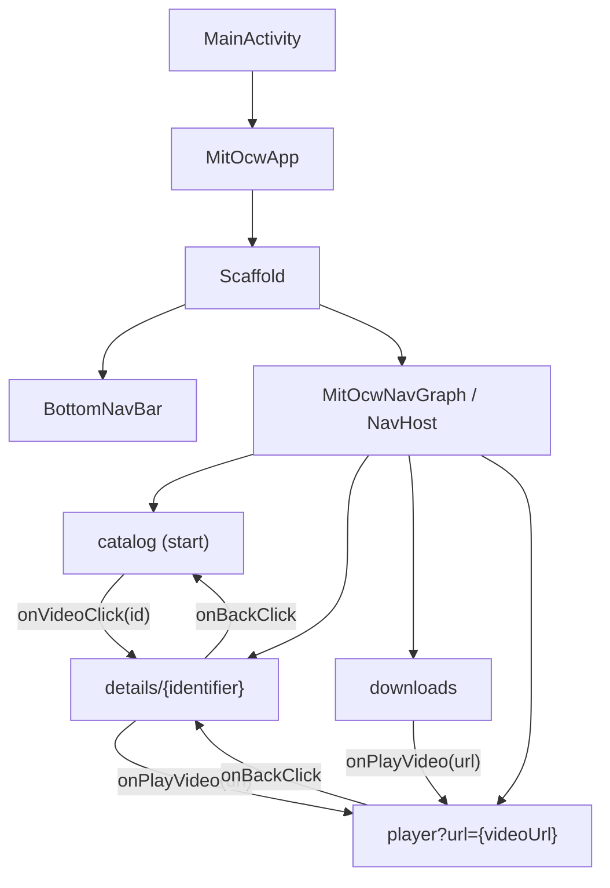

# Navigation

## Navigation Architecture

Single-Activity, multi-Composable navigation with `NavHost`.



## Route Definitions

```kotlin
object NavRoutes {
    const val CATALOG = "catalog"
    const val DETAILS = "details/{identifier}"
    const val DOWNLOADS = "downloads"
    const val PLAYER = "player?url={videoUrl}"

    const val DEEP_LINK_SCHEME = "imit"
    const val DEEP_LINK_HOST = "app"
    const val DEEP_LINK_BASE_URI = "$DEEP_LINK_SCHEME://$DEEP_LINK_HOST"

    const val DETAILS_DEEP_LINK_PATTERN = "$DEEP_LINK_BASE_URI/details/{identifier}"
    const val DOWNLOADS_DEEP_LINK_PATTERN = "$DEEP_LINK_BASE_URI/downloads"

    fun detailsRoute(identifier: String): String = "details/$identifier"
    fun detailsDeepLinkUri(identifier: String): String = "$DEEP_LINK_BASE_URI/details/$identifier"
    fun downloadsDeepLinkUri(): String = "$DEEP_LINK_BASE_URI/downloads"
    fun playerRoute(videoUrl: String): String =
        "player?url=${URLEncoder.encode(videoUrl, "UTF-8")}"
}
```

| Route | Pattern | Arguments | Description | Deep Link URI |
|-------|---------|-----------|-------------|---------------|
| Catalog | `catalog` | None | Start destination. Video grid. | - |
| Details | `details/{identifier}` | `identifier: String` (path) | Video detail screen. | `imit://app/details/{identifier}` |
| Downloads | `downloads` | None | Downloaded videos. | `imit://app/downloads` |
| Player | `player?url={videoUrl}` | `videoUrl: String` (query, optional) | Video player. URL-encoded. | - |

## NavHost Configuration

```kotlin
NavHost(
    navController = navController,
    startDestination = NavRoutes.CATALOG,
    modifier = modifier
) {
    composable(NavRoutes.CATALOG) { /* CatalogScreen */ }
    composable(
        route = NavRoutes.DETAILS,
        arguments = listOf(navArgument("identifier") { type = NavType.StringType }),
        deepLinks = listOf(
            navDeepLink { uriPattern = NavRoutes.DETAILS_DEEP_LINK_PATTERN }
        )
    ) { backStackEntry ->
        val identifier = backStackEntry.arguments?.getString("identifier").orEmpty()
        DetailScreen(
            identifier = identifier,
            onBackClick = {
                if (!navController.popBackStack()) {
                    navController.navigate(NavRoutes.CATALOG) {
                        popUpTo(0) { inclusive = true }
                    }
                }
            },
            onPlayVideo = { videoUrl ->
                navController.navigate(NavRoutes.playerRoute(videoUrl))
            }
        )
    }
    composable(
        route = NavRoutes.DOWNLOADS,
        deepLinks = listOf(
            navDeepLink { uriPattern = NavRoutes.DOWNLOADS_DEEP_LINK_PATTERN }
        )
    ) { /* DownloadsScreen */ }
    composable(
        route = NavRoutes.PLAYER,
        arguments = listOf(navArgument("videoUrl") {
            type = NavType.StringType
            defaultValue = ""
        })
    ) { /* VideoPlayerScreen */ }
}
```

## Deep Linking & Back Stack Synthesis

### Architecture & Scheme Configuration

IMIT registers a custom private URI scheme for internal and external navigation:
- Scheme: `imit`
- Host: `app`

### URI Scheme Reference

| Destination | Route Constant | Deep Link URI Template | Arguments | Target Component |
|-------------|----------------|------------------------|-----------|------------------|
| Catalog | `NavRoutes.CATALOG` | `imit://app/catalog` | None | `CatalogScreen` (Root) |
| Video Details | `NavRoutes.DETAILS` | `imit://app/details/{identifier}` | `identifier` (String) | `DetailScreen` |
| Downloads | `NavRoutes.DOWNLOADS` | `imit://app/downloads` | None | `DownloadsScreen` |
| Video Player | `NavRoutes.PLAYER` | `imit://app/player?url={videoUrl}` | `videoUrl` (URL-encoded String) | `VideoPlayerScreen` |

### Manifest Filter Configuration

```xml
  <activity
      android:name=".MainActivity"
      android:launchMode="singleTop" ...>
      <intent-filter>
          <action android:name="android.intent.action.VIEW" />
          <category android:name="android.intent.category.DEFAULT" />
          <category android:name="android.intent.category.BROWSABLE" />
          <data android:scheme="imit" android:host="app" />
      </intent-filter>
  </activity>
  ```

### SingleTop & onNewIntent Delegation

`MainActivity` is configured with `android:launchMode="singleTop"` to prevent duplicate Activity instances when tapping notifications or repeated external links.
Incoming intents in warm states are delegated to `NavController`:

```kotlin
override fun onNewIntent(intent: Intent) {
    super.onNewIntent(intent)
    setIntent(intent)
    navController?.handleDeepLink(intent)
}
```

### DeepLinkHelper & TaskStackBuilder

For system notifications and background tasks, `DeepLinkHelper` synthesizes a full parent back stack using `TaskStackBuilder`:

```kotlin
object DeepLinkHelper : DownloadNotificationNavigator {
    const val REQUEST_CODE_DETAILS = 1001
    const val REQUEST_CODE_DOWNLOADS = 1002

    override fun createDetailsPendingIntent(
        context: Context,
        identifier: String
    ): PendingIntent = createDetailsPendingIntent(context, identifier, REQUEST_CODE_DETAILS)

    fun createDetailsPendingIntent(
        context: Context,
        identifier: String,
        requestCode: Int = REQUEST_CODE_DETAILS
    ): PendingIntent {
        val intent = createDetailsIntent(context, identifier)
        return TaskStackBuilder.create(context).run {
            addNextIntentWithParentStack(intent)
            getPendingIntent(
                requestCode,
                PendingIntent.FLAG_UPDATE_CURRENT or PendingIntent.FLAG_IMMUTABLE
            )!!
        }
    }

    override fun createDownloadsPendingIntent(
        context: Context
    ): PendingIntent = createDownloadsPendingIntent(context, REQUEST_CODE_DOWNLOADS)

    fun createDownloadsPendingIntent(
        context: Context,
        requestCode: Int = REQUEST_CODE_DOWNLOADS
    ): PendingIntent {
        val intent = createDownloadsIntent(context)
        return TaskStackBuilder.create(context).run {
            addNextIntentWithParentStack(intent)
            getPendingIntent(
                requestCode,
                PendingIntent.FLAG_UPDATE_CURRENT or PendingIntent.FLAG_IMMUTABLE
            )!!
        }
    }
}
```

### Notification Navigation Inversion (`DownloadNotificationNavigator`)

To decouple background download workers in `:core:download` from `:app` without circular dependencies, `:core:download` defines `DownloadNotificationNavigator`. `DeepLinkHelper` implements this contract in `:app`, and Koin registers it via `appModule`:
- **Active Progress:** Worker attaches `createDownloadsPendingIntent(context)` to progress notification, opening `DownloadsScreen` (`imit://app/downloads`) with ongoing status (`FLAG_ONGOING_EVENT`).
- **Completion Alert:** Worker attaches `createDetailsPendingIntent(context, identifier)` to completion notification with auto-cancel (`FLAG_AUTO_CANCEL`), opening `DetailScreen` (`imit://app/details/{identifier}`).
- **Failure Alert:** Worker attaches `createDetailsPendingIntent(context, identifier)` to failure notification with auto-cancel (`FLAG_AUTO_CANCEL`) on storage exhaustion (<500MB) or network errors.

### Parent Back Stack Guarantee

1. **Cold Start via Deep Link:** Compose `NavHost` synthesizes `NavRoutes.CATALOG` as the root destination beneath the deep-linked screen.
2. **Warm Start via `onNewIntent`:** `navController.handleDeepLink(intent)` preserves the parent hierarchy.
3. **Back Navigation:** Pressing system Back or tapping top bar arrow from `DetailScreen` always returns the user to `CatalogScreen`. Fallback pop navigation (`if (!navController.popBackStack()) navigate(CATALOG)`) guarantees no user trap.

## URL Parameter Encoding

Player route uses URL-encoded video URL to handle special characters:

```kotlin
// Encoding (navigation call)
NavRoutes.playerRoute(videoUrl)
// → "player?url=https%3A%2F%2Farchive.org%2Fdownload%2F..."

// Decoding (destination)
val encodedUrl = backStackEntry.arguments?.getString("videoUrl").orEmpty()
val videoUrl = URLDecoder.decode(encodedUrl, "UTF-8")
```

## Bottom Navigation Bar

### Configuration

| Tab | Route | Selected Icon | Unselected Icon |
|-----|-------|--------------|-----------------|
| Catalog | `catalog` | `Icons.Filled.VideoLibrary` | `Icons.Outlined.VideoLibrary` |
| Downloads | `downloads` | `Icons.Filled.Download` | `Icons.Outlined.Download` |

### Visibility

Bottom bar only visible on top-level tabs:

```kotlin
fun shouldShowBottomBar(currentRoute: String?): Boolean {
    return when (currentRoute) {
        NavRoutes.CATALOG,
        NavRoutes.DOWNLOADS -> true
        else -> false  // Hidden on details, player
    }
}
```

### Navigation Behavior

```kotlin
navController.navigate(item.route) {
    popUpTo(navController.graph.findStartDestination().id) {
        saveState = true        // Save tab state when switching
    }
    launchSingleTop = true      // Prevent duplicate destinations
    restoreState = true         // Restore tab state when returning
}
```

This gives standard Android tab behavior:
- Tab state preserved when switching tabs
- Back press from non-start tab goes to start destination
- No duplicate tab entries in back stack

### BottomNavItem Sealed Class

```kotlin
sealed class BottomNavItem(
    val route: String,
    val title: String,
    val selectedIcon: ImageVector,
    val unselectedIcon: ImageVector
) {
    data object Catalog : BottomNavItem(...)
    data object Downloads : BottomNavItem(...)

    companion object {
        val items = listOf(Catalog, Downloads)
    }
}
```

## Screen-to-ViewModel Parameter Passing

### Catalog (no parameters)

```kotlin
viewModel: CatalogViewModel = koinViewModel()
```

### Details (identifier parameter)

```kotlin
// Koin parametersOf for assisted injection
viewModel: DetailViewModel = koinViewModel(parameters = { parametersOf(identifier) })
```

ViewModel constructor:
```kotlin
class DetailViewModel(
    private val identifier: String,    // Injected via parametersOf
    private val videoRepository: VideoRepository,
    private val downloadedVideoDao: DownloadedVideoDao
) : ViewModel()
```

### Player (no ViewModel, injected manager)

```kotlin
val playerManager: VideoPlayerManager = koinInject()
```

## Navigation Events from ViewModel

Detail screen navigates to player via one-shot StateFlow:

```kotlin
// ViewModel
private val _navigateToPlayer = MutableStateFlow<String?>(null)
val navigateToPlayer: StateFlow<String?> = _navigateToPlayer.asStateFlow()

// Screen
LaunchedEffect(navigateToPlayer) {
    navigateToPlayer?.let { videoUrl ->
        onPlayVideo(videoUrl)              // Execute navigation
        viewModel.onPlayerNavigated()      // Reset to prevent re-navigation
    }
}
```

This avoids passing `NavController` to ViewModel (separation of concerns).

## Screen Composable Contracts

Each screen receives navigation callbacks as parameters:

| Screen | Navigation Params |
|--------|------------------|
| `CatalogScreen` | `onVideoClick: (identifier: String) -> Unit` |
| `DetailScreen` | `onBackClick: () -> Unit`, `onPlayVideo: (videoUrl: String) -> Unit` |
| `DownloadsScreen` | `onPlayVideo: (videoUrl: String) -> Unit` |
| `VideoPlayerScreen` | `onBackClick: () -> Unit` |

NavGraph wires these to `navController.navigate()` and `navController.popBackStack()`.
